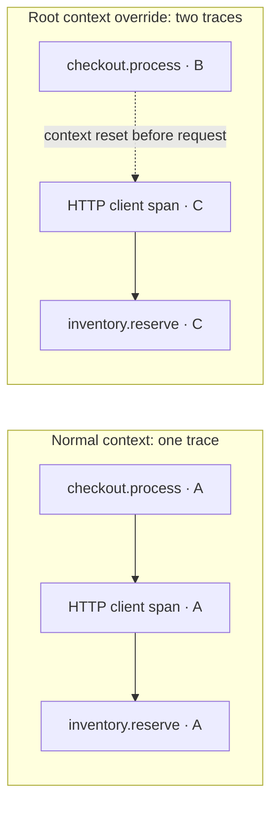

# Diagnose a split trace and verify recovery

**Source:** my separate public OpenTelemetry case study. The application and checkout flow are synthetic.

A healthy HTTP response does not prove that a distributed trace is connected. This tutorial deliberately breaks context propagation between a synthetic checkout flow and its inventory operation, finds the two resulting traces in Tempo, and restores a connected journey.

**Reader:** a developer or operator learning to validate an OpenTelemetry pipeline. **Result:** an identified failure and a fresh recovery probe, checked against local backends. The underlying case-study documentation is my existing work; this corrected procedure and its verification helpers were prepared with Codex during portfolio review.

Alloy receives and forwards the application's telemetry. The local LGTM container bundles Grafana for exploration, Tempo for traces, Loki for logs, and Prometheus for metrics.

## Prerequisites

- Git, Node.js **24** (tested with **24.21.0**), and npm (tested with **10.9.3**).
- Docker Desktop or Docker Engine with Compose v2 or later, running Linux containers.
- Windows PowerShell with permission to run local scripts, or a POSIX shell on Linux/macOS. Windows PowerShell commands and the POSIX launcher were exercised on Windows; Linux/macOS execution has not been tested.
- Network access to fetch the public Git repository, locked npm dependencies, and container images.
- Available local ports **18080**, **3000**, **12345**, and **4318**. The containers keep their own internal ports.

Use a disposable checkout and the dedicated Compose project name below. Commands containing `down -v` delete that project's demonstration data. No hosted account, production credentials, or paid service is needed.

## Prepare the corrected source

Run these commands from the portfolio root. The destination `.local/otel` must not already exist:

```sh
git clone --config core.autocrlf=false https://github.com/Umphman/otel-onboarding-experience-case-study.git .local/otel
git -C .local/otel checkout --detach cc80d436d65e09854102ddb005d11a76bd2a9a60
git -C .local/otel apply --check ../../otel/local-corrections.patch
git -C .local/otel apply ../../otel/local-corrections.patch
cd .local/otel
```

The [patch](local-corrections.patch) supplies portfolio corrections to that exact public revision. The [manifest](correction-manifest.json) records the base revision and file hashes. If `git apply --check` fails, stop and check the revision and working directory; do not force the patch.

The launchers below remove inherited `OTEL_*`, `GRAFANA_CLOUD_*`, Node preload settings, and `COMPOSE_FILE` **before** starting the tools. They preserve the local demo port and `COMPOSE_PROJECT_NAME`. The backend verifiers also select this checkout's `docker-compose.yml` explicitly. Use the launcher for the commands below.

### Check Windows script permissions

In PowerShell, inspect the effective policy before running the launcher:

```powershell
Get-ExecutionPolicy -List
Get-ExecutionPolicy
```

If the effective policy is `Restricted`, direct `.ps1` commands will be blocked. If your organization's policy permits local scripts, start a temporary Windows PowerShell session from this checkout:

```powershell
powershell.exe -NoProfile -ExecutionPolicy RemoteSigned
```

Continue with the PowerShell commands below inside that session. This setting applies only to the new process and its children; it does not change the saved user or machine policy. Close the session with `exit` when finished. If Group Policy blocks script execution, use an environment approved by your administrator; a process setting cannot override it. See [PowerShell execution policies](https://learn.microsoft.com/en-us/powershell/module/microsoft.powershell.core/about/about_execution_policies).

### Install and check the examples

Choose the command block for your shell and keep using that terminal.

**PowerShell**

```powershell
$env:COMPOSE_PROJECT_NAME = 'writing-portfolio-otel'
$env:DEMO_HTTP_PORT = '18080'
$env:PIPELINE_APP_URL = 'http://127.0.0.1:18080'
.\scripts\run-local.ps1 node --version
.\scripts\run-local.ps1 npm ci --ignore-scripts
.\scripts\run-local.ps1 npm test
.\scripts\run-local.ps1 npm run verify:signals
```

**POSIX shell**

```sh
export COMPOSE_PROJECT_NAME=writing-portfolio-otel
export DEMO_HTTP_PORT=18080
export PIPELINE_APP_URL=http://127.0.0.1:18080
sh scripts/run-local.sh node --version
sh scripts/run-local.sh npm ci --ignore-scripts
sh scripts/run-local.sh npm test
sh scripts/run-local.sh npm run verify:signals
```

Check that Node prints `v24.x.x`. Expected: all applicable tests pass out of **31 total**, followed by three passing signal scenarios: explicit SDK, automatic instrumentation, and deliberately broken propagation. The audited Windows/Git Bash run passed 31/31. Platform-specific launcher tests and Docker CLI checks can skip when their prerequisites are unavailable. These signal checks use a local mock receiver; they do not establish receipt by Tempo, Loki, or Prometheus.

## Establish the healthy baseline

Start only the observability stack and application; leave the load generator stopped so metric deltas remain attributable to the verifier's request.

**PowerShell**

```powershell
.\scripts\run-local.ps1 docker compose -f docker-compose.yml up -d --build --wait lgtm alloy app
.\scripts\run-local.ps1 npm run verify:pipeline
```

**POSIX shell**

```sh
sh scripts/run-local.sh docker compose -f docker-compose.yml up -d --build --wait lgtm alloy app
sh scripts/run-local.sh npm run verify:pipeline
```

Expected: app and LGTM become healthy, Alloy is running, the verifier prints a new probe and trace ID, and the last line is `pipeline verification passed` with exit status **0**. It checks Alloy receipt/export activity, the connected trace in Tempo, correlated logs in Loki, and request/duration metric deltas in Prometheus. Image downloads and startup take longer than the process tests.

## Understand the context boundary

A span describes an operation; its trace ID ties it to the other operations in the same journey. In normal mode, HTTP instrumentation carries the active checkout context into the inventory request, so `checkout.process` and `inventory.reserve` share a trace ID.

This demo makes an HTTP request back to another endpoint in the **same Node.js application**. It models a context boundary without requiring two separately deployed services.

The failure override selects `DEMO_SCENARIO=broken-context-propagation`. The [inventory client](https://github.com/Umphman/otel-onboarding-experience-case-study/blob/cc80d436d65e09854102ddb005d11a76bd2a9a60/app/service.js#L109-L120) then starts that HTTP operation under an empty root context:

```js
if (scenario === 'broken-context-propagation') {
  return context.with(ROOT_CONTEXT, operation);
}
return operation();
```

Starting under `ROOT_CONTEXT` discards the active checkout parent for this call. HTTP instrumentation creates a new trace for the outgoing request, and the inventory operation follows that new context. The application still responds and exports spans, but the backend receives two disconnected traces.

This diagram simplifies the span relationships; HTTP server spans are omitted, and A, B, and C stand for different trace IDs:



## Reproduce and inspect broken propagation

Recreate the disposable project with the failure override.

**PowerShell**

```powershell
.\scripts\run-local.ps1 docker compose -f docker-compose.yml down -v --remove-orphans
.\scripts\run-local.ps1 docker compose -f docker-compose.yml -f scenarios/broken-context-propagation/compose.override.yml up -d --build --wait lgtm alloy app
.\scripts\run-local.ps1 npm run verify:context
```

**POSIX shell**

```sh
sh scripts/run-local.sh docker compose -f docker-compose.yml down -v --remove-orphans
sh scripts/run-local.sh docker compose -f docker-compose.yml -f scenarios/broken-context-propagation/compose.override.yml up -d --build --wait lgtm alloy app
sh scripts/run-local.sh npm run verify:context
```

The verifier sends one identified checkout request and waits up to 90 seconds for its traces. Expected output, with different identifiers on each run:

```text
probe: broken-context-<unique identifier>
checkout trace: <32 hexadecimal characters>
inventory trace: <different 32 hexadecimal characters>
Tempo: checkout.process and inventory.reserve found in separate traces for this probe
broken-context verification passed (the expected defect is present)
```

Exit status **0** means the intentional defect was reproduced. The helper checks both stored traces, their service identity, and their probe identifier; two IDs echoed by an application would be insufficient.

Inspect the traces in Grafana:

1. Open `http://localhost:3000` and choose **Explore**.
2. Select the **Tempo** data source, then the **TraceQL** tab.
3. Paste the printed checkout trace ID into the query field and select **Run query**. Its trace contains `checkout.process` without `inventory.reserve`.
4. Replace the query with the printed inventory trace ID and select **Run query**. This trace contains `inventory.reserve` without `checkout.process`.

The shared probe ties both traces to the same request. Export succeeded; the missing relationship arose when the application reset the active context. See [Grafana's trace-ID query instructions](https://grafana.com/docs/grafana/latest/datasources/tempo/query-editor/traceql-editor/#query-by-traceid).

## Restore propagation and prove recovery

Remove the failure override by recreating the default stack. Normal mode calls `operation()` in the active checkout context, allowing HTTP instrumentation to preserve the trace relationship.

**PowerShell**

```powershell
.\scripts\run-local.ps1 docker compose -f docker-compose.yml -f scenarios/broken-context-propagation/compose.override.yml down -v --remove-orphans
.\scripts\run-local.ps1 docker compose -f docker-compose.yml up -d --build --wait lgtm alloy app
.\scripts\run-local.ps1 npm run verify:pipeline
```

**POSIX shell**

```sh
sh scripts/run-local.sh docker compose -f docker-compose.yml -f scenarios/broken-context-propagation/compose.override.yml down -v --remove-orphans
sh scripts/run-local.sh docker compose -f docker-compose.yml up -d --build --wait lgtm alloy app
sh scripts/run-local.sh npm run verify:pipeline
```

Require a **new** probe ID, a connected trace, and `pipeline verification passed` with exit status **0**. Search the new trace ID in Tempo: both operations must appear in one trace. Neither an old successful trace nor the earlier split traces prove recovery.

## If a check fails

| Observation | Next action |
| --- | --- |
| PowerShell says running scripts is disabled | Follow [Check Windows script permissions](#check-windows-script-permissions). Check the effective policy before retrying; do not change a saved machine policy to run this demo. |
| Application host port 18080 is unavailable | Choose an unused host port; change both `DEMO_HTTP_PORT` and the port in `PIPELINE_APP_URL`, then recreate the stack. Keep the internal container port unchanged. |
| Port 3000, 12345, or 4318 is unavailable | Free the required port if you control the conflicting service, or run the tutorial on another local machine with these ports available. Changing the application port does not move these listeners. |
| Expected split is absent | Confirm the startup command includes both Compose files. This check should fail against a healthy stack. |
| Tempo receipt times out | Run the status and log commands below. Application success alone does not establish backend receipt. |
| Verifier detects `loadgen` | Use the stop command for your shell below, then rerun the probe. |
| Exporter failure-counter series are unavailable | Preserve that limitation in the result. Missing counters do not prove zero failures. |

Status and logs, in PowerShell:

```powershell
.\scripts\run-local.ps1 docker compose -f docker-compose.yml ps
.\scripts\run-local.ps1 docker compose -f docker-compose.yml logs --tail 50 alloy lgtm
```

In a POSIX shell:

```sh
sh scripts/run-local.sh docker compose -f docker-compose.yml ps
sh scripts/run-local.sh docker compose -f docker-compose.yml logs --tail 50 alloy lgtm
```

If the verifier reports a running load generator, stop it in PowerShell:

```powershell
.\scripts\run-local.ps1 docker compose -f docker-compose.yml stop loadgen
```

Or in a POSIX shell:

```sh
sh scripts/run-local.sh docker compose -f docker-compose.yml stop loadgen
```

## Clean up

After recovery, remove only this disposable project's containers and volumes. Keep the same `COMPOSE_PROJECT_NAME`:

```powershell
.\scripts\run-local.ps1 docker compose -f docker-compose.yml down -v --remove-orphans
```

POSIX equivalent:

```sh
sh scripts/run-local.sh docker compose -f docker-compose.yml down -v --remove-orphans
```

The [verification record](../VERIFICATION.md) documents the local results and their limits.
